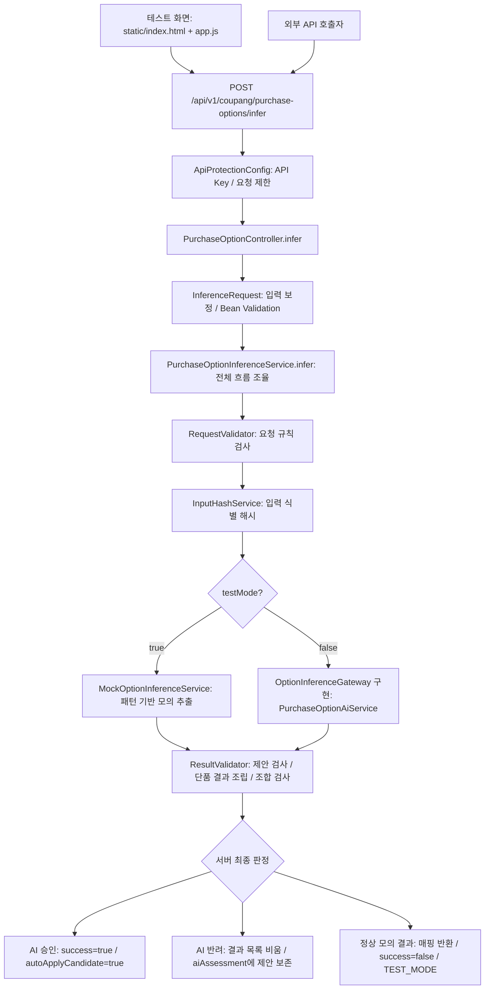
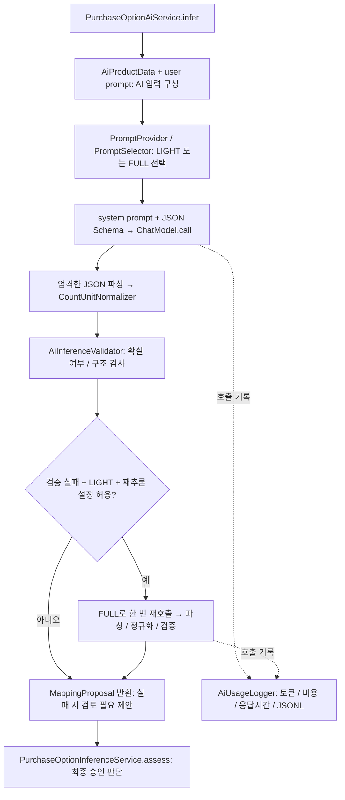

# 소스 읽기 지도

현재 소스 기준으로 이 프로젝트는 상품의 원본 옵션명과 상품 정보를 받아 쿠팡 구매옵션으로 변환하는 Java 17 / Spring Boot 서비스다. 예를 들어 `블랙/90`을 `색상=블랙`, `패션의류/잡화 사이즈=90`으로 매핑한다. 결과를 반환하며 상품이나 DB를 직접 수정하지 않는다.

## 1. 전체 요청 흐름

DTO 생성·보정과 Bean Validation은 컨트롤러 메서드 실행 전에 Spring이 처리한다. 도식에서는 소스 읽기 위치를 보여주기 위해 컨트롤러와 DTO를 이어 표시했다. 요청 오류와 AI 통신 오류는 정상 결과 판정과 별도로 `GlobalExceptionHandler`가 HTTP 오류 응답으로 변환한다.

## 2. 실제 AI 내부 흐름

- AUTO 선택에서 단위 설정 없는 일반 색상·사이즈·핏 추출은 LIGHT, 계산형·단위 설정·알 수 없는 옵션 등은 FULL을 사용한다. 설정으로 모드를 지정할 수도 있다.
- 기본 동작에서 낮은 신뢰도만으로 재호출하지 않는다. 재추론용 신뢰도 검사는 별도 설정이며, 최종 승인 기준과 구분된다.
- AI 통신 오류는 LIGHT → FULL 재추론 대상이 아니다.
- 최종 AI 승인은 `certain=true`, 전체·개별 매핑 최저 신뢰도 기준 충족(기본 0.80), 구조·단위 형식·단품 조합 검사 통과가 필요하다.
- 서버는 실제 AI 결과의 의미와 계산을 다시 검증하지 않는다. 승인되었다고 수학적 정확성이 보장되는 것은 아니다.

## 3. 추천 읽기 순서

Java 소스 경로의 공통 접두사는 `src/main/java/com/cware/ai/`다.

| 순서 | 파일 | 여기서 파악할 것 |
|---|---|---|
| 1 | `examples/ai-request.json` | 실제 요청이 어떻게 생겼는지 |
| 2 | `dto/InferenceRequest.java`, `dto/InferenceResponse.java` | 입력·출력 계약, 입력 기본값과 보정 |
| 3 | `controller/PurchaseOptionController.java` | API 주소, testMode, 서비스 진입점 |
| 4 | `service/PurchaseOptionInferenceService.java` | 핵심: infer → assess / simulate, 승인·반려 조건 |
| 5 | `inference/ResultValidator.java` | validateProposal → assemble → validateItems |
| 6 | `inference/PurchaseOptionAiService.java` | infer → attempt → parse, AI 호출과 재추론 |
| 7 | `inference/PurchaseOptionPromptSelector.java`, `PurchaseOptionPromptProvider.java` | LIGHT/FULL 분기와 프롬프트 로딩 |
| 8 | `src/main/resources/prompts/` | AI에게 실제로 주는 판단 규칙 |
| 9 | `src/test/java/com/cware/ai/InferenceServiceTest.java`, `AiFailoverTest.java`, `PurchaseOptionApiTest.java` | 기대 동작을 구체적인 입력·출력으로 확인 |

처음에는 1~5까지만 읽고, `블랙/90` 요청 하나가 어디서 들어와 어떤 조건으로 승인되는지 따라가면 된다. 그다음 AI 호출 내부를 읽으면 전체 구조에 연결하기 쉽다.

## 4. 패키지 지도

| 위치 | 역할 | 읽는 시점 |
|---|---|---|
| `controller` | HTTP 진입점 | 처음 |
| `dto` | 요청·응답·AI 제안 관련 데이터 | 처음 |
| `service` | 전체 처리와 최종 판정 | 처음, 가장 중요 |
| `inference` | AI 호출·프롬프트 선택·검증·모의 추출 | 핵심 흐름 다음 |
| `config` | AI 클라이언트, 타임아웃·신뢰도·재추론·가격 설정 | 설정 확인 시 |
| `security` | 서비스 API Key와 호출 제한 | API 인증 확인 시 |
| `exception` | 오류를 HTTP 응답으로 변환 | 오류 처리 확인 시 |
| `util` | 입력 해시 | 입력 식별 확인 시 |
| `resources/static` | 테스트 화면과 사용자·API 문서 | 화면 흐름 확인 시 |
| `agent`, `tool` | 향후 확장용 package-info | 마지막 |

`*Context`와 `MockCalculation` 등 상세 수량 처리 코드는 우선 뒤로 미뤄도 된다. 파일 이름만 보고 실제 AI 승인 경로에서 사용한다고 판단하지 말고 호출 위치를 확인한다. 특히 `ResultValidator`의 실제 AI 승인 흐름은 수량 계열(`QuantityEvidenceValidator`)과 포장당 용량(`PackCapacityNormalizer`)을 제외하면 원문 숫자 대조나 계산 재수행을 하지 않는다.

## 5. IntelliJ에서 따라가는 방법

1. `PurchaseOptionController.infer()`에서 `service.infer()`로 이동한다.
2. `PurchaseOptionInferenceService.infer()`에서 `requestValidator.validate()`, `ai.infer()`, `assess()`를 순서대로 확인한다.
3. `ai.infer()`는 인터페이스이므로 구현체 `PurchaseOptionAiService`로 이동한다.
4. AI 결과 타입 `MappingProposal`과 최종 응답 타입 `InferenceResponse`를 비교한다.
5. 테스트에서 `success`, `autoApplyCandidate`, `serverAssessment`를 검사하는 부분을 읽어 승인과 반려의 차이를 확인한다.

Mermaid를 지원하는 Markdown 뷰어에서 이 문서의 도식을 볼 수 있다.
